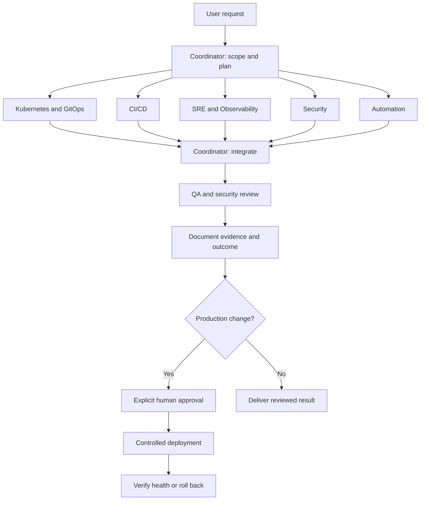

# DevOps multi-agent implementation plan

## Proposed operating model

Use the main Codex session as coordinator. Delegate bounded tasks to the six
specialists as needed; a roster of six roles does not require six simultaneous
agents. Start with two concurrent independent tasks and adjust after a pilot.
Confirm this proposal against project context before configuring runtime agents.

## Specialist responsibilities

| Role | Owns | Expected output |
| --- | --- | --- |
| Coordinator | Planning, dependencies, integration, approvals | Task graph, reviewed change, outcome |
| Kubernetes and GitOps | Manifests, Helm/Kustomize, reconciliation, rollout | Rendered diff, validation, rollback steps |
| CI/CD | Build, test, artifact and deployment pipelines | Pipeline diff, execution evidence |
| SRE and Observability | SLOs, metrics, logs, alerts, runbooks | Health criteria, alert checks, incident guidance |
| Security | IAM/RBAC, secrets handling, supply chain, policy | Findings with severity and remediation |
| Automation | Repeatable scripts and infrastructure workflows | Idempotent tooling and usage documentation |
| QA | Independent acceptance and regression verification | Check results, evidence, remaining gaps |

## Phases and completion criteria

### 0. Establish context

Inventory the target project and installed CLI using read-only discovery.
Fill the missing facts in `chatgpt-context.md`. Identify deployment triggers and
production boundaries. Record proposed choices and reasons before implementation.

Done when the pilot scope, tooling, environments, and approval owner are known.

### 1. Define agents and controls

Verify supported configuration against the installed CLI and official docs.
Create project-local role definitions and configuration using that supported
format. Give reviewers read-only access where tooling permits. Start workers
with local workspace permissions and no production credentials. Use templates
to define task ownership and shared reporting conventions.

Done when role routing works in a local session, permission boundaries are
verified, and independent agents cannot overwrite the same owned files.
Instructions alone are not an enforcement mechanism; enforce production access
through credentials, RBAC, and protected delivery workflows.

### 2. Run one local pilot

Choose a small existing example after inventory. Proposed pilot: validate a
sample Kubernetes deployment and its delivery checks without a cluster mutation.
Delegate manifest review and pipeline review independently. Integrate their
results; run independent QA and security review on the integrated revision.

Done when the workflow produces one reviewed change with repeatable checks,
clear evidence, and no outstanding blocking findings.

### 3. Add non-production integration

Connect approved repository, CI, cluster, and observability tools with scoped
identities. Test the complete flow in a disposable environment. Verify rollout,
health checks, alerts, and rollback. Record command output with secret redaction.

Done when a deployment and rollback rehearsal both pass and failures are
reported accurately.

### 4. Add production delivery gates

Prepare a reviewable change package: exact revision, rendered infrastructure
diff, target environment, tests, security findings, health thresholds, and rollback.
Require explicit approval from the designated human before production execution
or a merge/sync that triggers it. Bind approval to that revision and environment;
changes invalidate approval. Enforce the gate with protected branches/environments
and an execution identity unavailable to ordinary agent sessions.

Done when an unapproved production action is demonstrably denied, approved
delivery is audited, and post-deployment failure invokes the agreed rollback process.

### 5. Expand with measured results

Add incident triage, drift review, dependency maintenance, and infrastructure
tasks one at a time. Track completion time, validation failures, human corrections,
and usage. Set concurrency and usage limits based on measured pilot results.

Done when each added workflow has acceptance tests, an owner, and a runbook.

## Execution and failure handling

Each task includes inputs, owned paths, allowed actions, dependencies, and checks.
Parallelize investigation and disjoint edits; serialize integration and deployment.
Use isolated worktrees for substantial independent code changes when practical.
The coordinator reviews all handoffs and resolves conflicting recommendations.
Missing facts, failed checks, unavailable tools, or conflicting edits block the
affected dependent step and appear in the outcome. Bound retries; report unresolved
failures rather than repeatedly executing changes.

## Validation strategy

Select checks from the actual stack: manifest rendering and schema/policy checks,
pipeline linting, script linting and behavioral tests, secret scanning, and
application tests. Run integration smoke tests in a disposable environment before
production. Verify negative paths: conflicting writes, failed QA, missing context,
and unapproved production attempts. QA reports exact commands, environment,
revision, exit status, and evidence; security reviews the integrated result.

## Sources and status

This plan is a proposal, not an implemented runtime. Codex supports subagent
delegation and custom roles; configuration must match the installed release.
[Official subagent documentation](https://learn.chatgpt.com/docs/agent-configuration/subagents).
